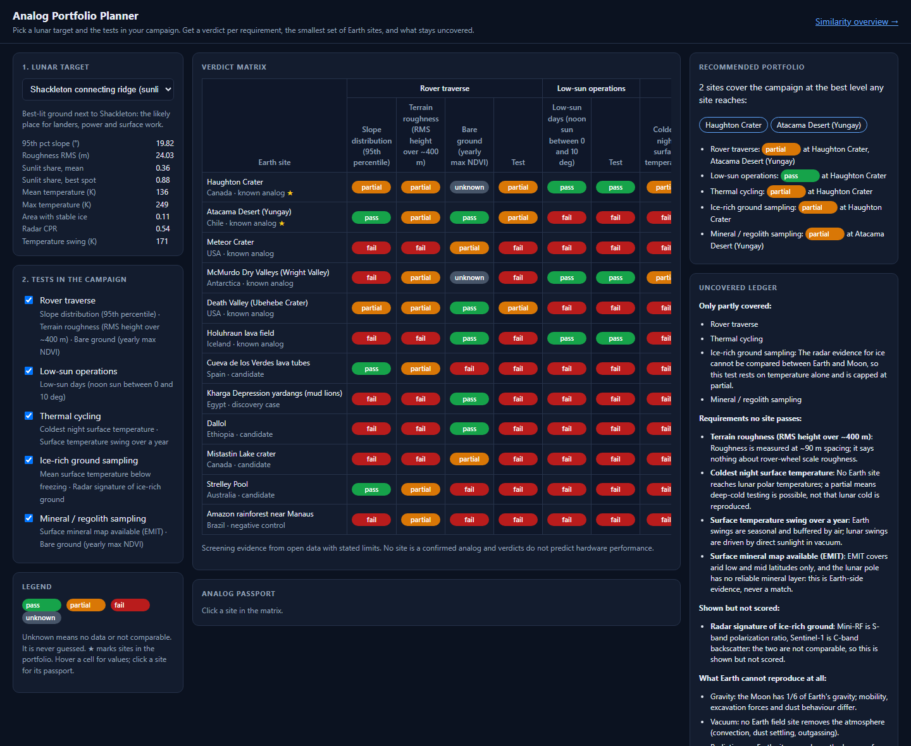

# bironinans-nasa

**Analog Portfolio Planner** — NASA Space Apps 2026, team BIRONIENS.

Existing tools list Earth places that look like the Moon. This one answers a narrower
question: *is this Earth site good enough for this test, and what can it not tell us?*

Pick a lunar south-pole target and the tests in a campaign (rover traverse, low-sun
operations, thermal cycling, ice-rich ground sampling, mineral sampling). The planner returns:

- a **pass / partial / fail / unknown** verdict per requirement for each Earth site, with the data behind it;
- the **smallest set of sites** that covers the campaign;
- an **uncovered ledger**: what no site covers, and what Earth cannot reproduce at all;
- an **Analog Passport** per site.



## Try it

Open `prototype/web/planner.html` in a browser (no server or install needed).
Deep links open a specific view, e.g. `planner.html?target=shackleton_floor&site=egypt_western_desert`.
`prototype/web/index.html` is an older single-score similarity overview.

A 3-minute demo script with talking points is in [docs/DEMO.md](docs/DEMO.md); screenshots are in `docs/screenshots/`.

## Rebuild from the raw data

```bash
pip install numpy scipy pandas tifffile imagecodecs h5py
python data-tools/download_raw_data.py   # ~2.5 GB of open NASA / ESA data
python data-tools/download_ndvi.py
python data-tools/extract_features.py    # -> Processed/features_*.csv
python data-tools/build_scores.py        # -> similarity overview data
python data-tools/qualify.py --report    # -> verdicts, portfolios, Processed/validation.md
```

Tests and thresholds are plain data in `data-tools/tests.json`.

## What is in the repo

| Path | What |
|---|---|
| `Problem Definition & Innovation Brief.docx` | Problem, users, existing tools, concept and data plan |
| `Raw Data/` | Site list, manifest (source URL + SHA-256 of every file) and dataset notes; the data itself is downloaded, not committed |
| `data-tools/` | Download, feature extraction, scoring and qualification scripts |
| `Processed/` | Extracted features and the validation report |
| `prototype/` | The planner and the similarity overview |
| `docs/` | Demo script and screenshots |

## Data

Earth: Copernicus DEM GLO-30, Sentinel-1 RTC, MODIS land surface temperature and NDVI, EMIT surface minerals.
Moon: LRO LOLA elevation and illumination, Diviner polar temperatures and ice stability, Mini-RF radar.
12 Earth sites: 6 known analogs, 5 candidates (including Egypt's Kharga Depression yardangs as the discovery case) and a rainforest negative control.

## Limits

Results are screening evidence from open data, not confirmed analogs, and they do not predict
hardware performance. Thresholds are first estimates. Missing data is shown as *unknown*, never
guessed. See `Processed/validation.md` and the limits listed in `prototype/README.md`.
